 

## ⚡ Current build

## 🧩 Featured projects

  
  

  
  

  
  

🟢 Try the <a href="https://kerala-digital-trust-73820029707.asia-south1.run.app/">Kerala AI Checker live demo</a>

## 🛠️ Tech stack

## 🧭 Journey

<b>🔭 What I'm exploring right now</b>

 

`Agentic AI workflows` · `GCP infrastructure` · `Terraform` · `DevSecOps` · `Multi-tenant SaaS` · `ERP & internal systems` · `Self-hosted tooling`

## 📈 GitHub activity

<picture>
  <source media="(prefers-color-scheme: dark)" srcset="https://raw.githubusercontent.com/Faheem-Musthafa/Faheem-Musthafa/output/github-contribution-grid-snake-dark.svg" />
  <source media="(prefers-color-scheme: light)" srcset="https://raw.githubusercontent.com/Faheem-Musthafa/Faheem-Musthafa/output/github-contribution-grid-snake.svg" />
  
</picture>

## 🤝 Let's build something

I'm open to **full-stack apps**, **AI-powered tools**, **SaaS MVPs**, **ERP & internal systems**, **backend & cloud infrastructure** and **automation projects**.

<b>Build useful things. Learn fast. Ship consistently.</b>

