<!-- Generated by scripts/build_assets.py. Edit the CONTENT section there, then re-run. -->
<!-- Each image has a light and a dark version; GitHub shows the one matching your theme. -->

 

 

  
  

  
  

  
  

Try <a href="https://github.com/Faheem-Musthafa/kerala-digital-trust-or-whatsapp-fact-checker">Kerala AI Checker</a> live.

 

 

 

  
  
  

