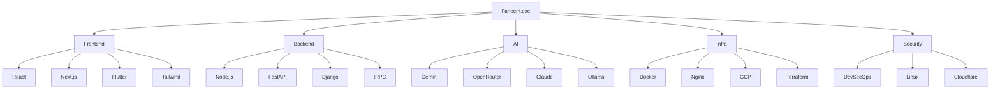

<div align="center">

```text
╔══════════════════════════════════════════════════════════════════════╗
║                                                                      ║
║   ····························································   ║
║   ·  ███████╗ █████╗ ██╗  ██╗███████╗███████╗███╗   ███╗       ·   ║
║   ·  ██╔════╝██╔══██╗██║  ██║██╔════╝██╔════╝████╗ ████║       ·   ║
║   ·  █████╗  ███████║███████║█████╗  █████╗  ██╔████╔██║       ·   ║
║   ·  ██╔══╝  ██╔══██║██╔══██║██╔══╝  ██╔══╝  ██║╚██╔╝██║       ·   ║
║   ·  ██║     ██║  ██║██║  ██║███████╗███████╗██║ ╚═╝ ██║       ·   ║
║   ·  ╚═╝     ╚═╝  ╚═╝╚═╝  ╚═╝╚══════╝╚══════╝╚═╝     ╚═╝       ·   ║
║   ····························································   ║
║                                                                      ║
╚══════════════════════════════════════════════════════════════════════╝
```

### `FULL-STACK DEVELOPER // AI BUILDER // AUTOMATION ENTHUSIAST`

```text
SYSTEM STATUS: ONLINE
LOCATION: KERALA, INDIA
MODE: BUILDING THINGS THAT SHOULD PROBABLY HAVE A README
```

[](https://linkedin.com/in/faheem-musthafa-cp)
[](https://instagram.com/faheem_cp)
[](mailto:faheemcp241@gmail.com)


</div>

---

# `CONTROL_ROOM / 01`

<table>
<tr>
<td width="58%" valign="top">

## `operator.profile`

```ts
const operator = {
  name: "Faheem Musthafa",
  role: "Full-Stack Developer & AI Builder",
  location: "Kerala, India",

  likes: [
    "Useful software",
    "Clean system design",
    "Automation",
    "Good dashboards",
    "Things running on my own server"
  ],

  currentlyLearning: [
    "GCP",
    "Terraform",
    "DevSecOps",
    "System Design"
  ],

  dangerLevel: "Will redesign your dashboard at 2 AM"
};
```

</td>
<td width="42%" valign="top">

## `live.telemetry`

```text
CPU      ████████░░  82%
FOCUS    █████████░  94%
COFFEE   ██████░░░░  63%
BUGS     ███░░░░░░░  28%
IDEAS    ██████████  100%
SLEEP    ██░░░░░░░░  classified
```

```text
> status --today

building...
debugging...
learning...
shipping...
```

</td>
</tr>
</table>

---

# `MISSION_BOARD / 02`

<div align="center">

```text
┌──────────────────────────────────────────────────────────────────────┐
│ ACTIVE MISSION                                                       │
├──────────────────────────────────────────────────────────────────────┤
│ RATECHECK                                                            │
│ AI-powered freelance pricing intelligence                           │
│                                                                      │
│ Input  : client project brief                                        │
│ Output : scope, complexity, estimate, structured pricing report      │
└──────────────────────────────────────────────────────────────────────┘
```

[](https://rate-check.vercel.app)

`Next.js` · `Supabase` · `OpenRouter` · `Redis` · `Resend` · `Vercel`

</div>

---

# `PROJECT_ARCADE / 03`

<table>
<tr>
<td width="50%" valign="top">

## `01 // Kerala AI Checker`

[](https://github.com/Faheem-Musthafa/kerala-digital-trust-or-whatsapp-fact-checker)
[](https://kerala-digital-trust-73820029707.asia-south1.run.app/)

```text
MISSION:
Detect suspicious Malayalam and Manglish
WhatsApp/SMS scam messages.

SPECIAL ABILITY:
Explains scams in simple language for
elderly and non-technical users.
```

`Next.js` `Gemini` `Cloud Run` `Tailwind`

</td>
<td width="50%" valign="top">

## `02 // RouteReport Live`

[](https://github.com/Faheem-Musthafa/Route-Report-system)

```text
MISSION:
Community-powered road issue reporting.

FEATURES:
GPS · live reports · maps · severity
filters · analytics · realtime updates
```

`React` `TypeScript` `Supabase` `Leaflet`

</td>
</tr>

<tr>
<td width="50%" valign="top">

## `03 // DadArch`

[](https://github.com/Faheem-Musthafa/DadArch)

```text
MISSION:
A premium architecture portfolio.

FOCUS:
Visual storytelling · project presentation
responsive layouts · deployment workflows
```

`Frontend` `Portfolio UX` `Vercel` `DNS`

</td>
<td width="50%" valign="top">

## `04 // IEDC MCAS Website`

[](https://github.com/Faheem-Musthafa/IEDC-MCAS-website)

```text
MISSION:
Digital home for college innovation,
programmes, events, and student activity.

MODE:
Community-first web experience
```

`Web Development` `Responsive UI` `Events`

</td>
</tr>

<tr>
<td width="50%" valign="top">

## `05 // LMS Backend`

[](https://github.com/Faheem-Musthafa/lms-backend)

```text
MISSION:
Backend foundations for learning systems.

MODULES:
Auth · content · data models · APIs
education workflows
```

`Backend` `API Design` `Education`

</td>
<td width="50%" valign="top">

## `06 // Self-Hosted Guide`

[](https://github.com/Faheem-Musthafa/self-hosted-guide)

```text
MISSION:
Run useful software on your own hardware.

TOOLS:
Linux · Nginx · Docker · Cloudflare
private services · automation
```

`Linux` `Docker` `Nginx` `Self-Hosting`

</td>
</tr>
</table>

---

# `SIDE_QUESTS / 04`

```text
[✓] Electra Shield        cybersecurity experiments
[✓] Moon Phase Tracker    astronomy + interface design
[✓] Smart Note            lightweight note system
[✓] Project AutoHub       project organization experiments
[✓] OpenTask              task management concepts
[✓] PassGuardian          password/security tooling
[✓] UniMinder             student productivity project
[✓] SIH_WEB_25            hackathon build
[✓] Slaq AI               AI product experiments
```

<div align="center">

[](https://github.com/Faheem-Musthafa?tab=repositories)

</div>

---

# `TECH_TREE / 05`



<div align="center">


</div>

---

# `SYSTEM_MAP / 06`

```text
┌──────────────┐
│ REAL PROBLEM │
└──────┬───────┘
       │
       ▼
┌──────────────┐
│ USER FLOWS   │
└──────┬───────┘
       │
       ▼
┌──────────────┐
│ DATA MODEL   │
└──────┬───────┘
       │
       ▼
┌──────────────┐
│ BACKEND/API  │
└──────┬───────┘
       │
       ▼
┌──────────────┐
│ INTERFACE    │
└──────┬───────┘
       │
       ▼
┌──────────────┐
│ DEPLOYMENT   │
└──────┬───────┘
       │
       ▼
┌──────────────┐
│ FEEDBACK LOOP│
└──────────────┘
```

```text
Developer rule #01:
Never automate a broken workflow before understanding why it is broken.

Developer rule #02:
A dashboard with 14 cards is usually asking for therapy.

Developer rule #03:
If it works on localhost, congratulations. The tutorial has begun.
```

---

# `GITHUB_RADAR / 07`

<div align="center">

<a href="https://github.com/Faheem-Musthafa">
  
</a>

<br/><br/>


<br/><br/>


<br/><br/>


</div>

---

# `ACHIEVEMENTS_UNLOCKED / 08`

```text
[ UNLOCKED ] Built real-world ERP workflows
[ UNLOCKED ] Deployed apps on Google Cloud
[ UNLOCKED ] Designed multi-role systems
[ UNLOCKED ] Built with Supabase RLS
[ UNLOCKED ] Survived DNS propagation
[ UNLOCKED ] Used Arch Linux voluntarily
[ LOCKED   ] Finish every side project
[ LOCKED   ] Close all browser tabs
```

---

# `CURRENT_QUESTS / 09`

<table>
<tr>
<td width="33%" valign="top">

### `AI`

```text
tool-using agents
multi-step workflows
local models
AI product UX
```

</td>
<td width="33%" valign="top">

### `CLOUD`

```text
GCP
Terraform
deployment
observability
```

</td>
<td width="33%" valign="top">

### `SYSTEMS`

```text
DevSecOps
multi-tenancy
ERP architecture
self-hosting
```

</td>
</tr>
</table>

---

# `TRANSMISSION / 10`

<div align="center">

```text
╭────────────────────────────────────────────────────────────────────╮
│ AVAILABLE FOR                                                      │
├────────────────────────────────────────────────────────────────────┤
│ Full-stack products                                                │
│ AI-powered tools                                                   │
│ SaaS MVPs                                                          │
│ ERP and internal systems                                           │
│ Automation workflows                                               │
│ Backend and cloud infrastructure                                   │
╰────────────────────────────────────────────────────────────────────╯
```

[](mailto:faheemcp241@gmail.com)
[](https://linkedin.com/in/faheem-musthafa-cp)

<br/><br/>

```text
······························································
··  BUILD USEFUL THINGS · BREAK A FEW · FIX THEM · SHIP AGAIN    ··
······························································
```

<sub>Powered by curiosity, Linux, caffeine, and suspiciously many terminal windows.</sub>

</div>
